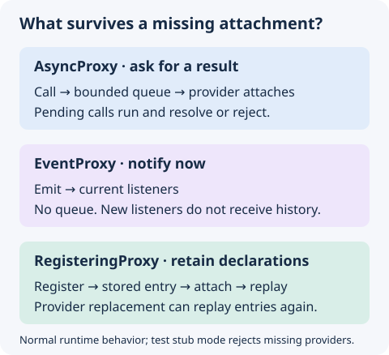

# Proxies

## Overview

Proxies are the backbone of cross-module communication in AntelopeJS. They provide module-aware abstractions for function calls, event handling, and registration patterns. Each proxy type automatically tracks the module that attaches callbacks and detaches them when that module is unloaded, preventing memory leaks and dangling references.

A proxy has a single provider and keeps its state on the proxy object itself. When a project has several providers of one interface, the core evaluates a separate instance of the interface package for each provider, so each instance's proxies reach exactly one provider; no call selects a provider at run time.

## Read the lifecycle before choosing a proxy



| Situation          | Async call             | Event                                   | Registration                                                         |
| ------------------ | ---------------------- | --------------------------------------- | -------------------------------------------------------------------- |
| No attachment      | Queues up to the limit | No listener receives it                 | Entry is retained                                                    |
| Attachment arrives | Pending calls run      | Future emissions reach listeners        | Stored entries replay                                                |
| Attachment leaves  | New calls queue again  | Removed listener stops receiving events | Entries remain until explicitly removed or their owner is cleaned up |

This table describes normal runtime behavior. [Test stub mode](#missingprovidererror) rejects missing providers. Detaching an async callback does not cancel work already running; detaching registration callbacks does not release provider resources.

## `AsyncProxy`

`AsyncProxy` wraps asynchronous function calls. It queues invocations when no callback is attached and flushes the queue once a callback becomes available. The queue holds at most 1,000 pending calls: once it is full, further calls reject with `ProviderQueueFullError` until a callback attaches.

### Create and use an `AsyncProxy`

```ts
import { AsyncProxy } from "@antelopejs/interface-core";

const proxy = new AsyncProxy<(name: string) => string>();

// Calls made before attachment are queued
const result = proxy.call("Alice"); // returns Promise<string>

// Attach an implementation - queued calls resolve immediately
proxy.onCall((name: string) => {
  return `Hello, ${name}!`;
});

// Subsequent calls execute directly
const greeting = await proxy.call("Bob"); // "Hello, Bob!"
```

### `onCall(callback, manualDetach?)`

Attaches the provider's callback to the proxy, replacing any callback attached before, so a provider's new generation takes over from the old one. The proxy automatically tracks the calling module and detaches the callback when that module is unloaded; releasing an older generation never detaches a newer one. Pass `manualDetach: true` to disable automatic cleanup.

When attachment occurs inside `RunWithModuleContext`, calls execute in the captured provider context rather than the consumer context. The captured module and owner generation remain available across nested calls and `await`. Calls reject with `ModuleContextInvalidatedError` if the captured owner has been destroyed.

```ts
// Automatic cleanup (default) - detaches when the module unloads
proxy.onCall(myHandler);

// Manual cleanup - retain the lease for generation-safe detachment
const lease = proxy.onCall(myHandler, true);
// Later:
proxy.detach(lease);
```

`onCall` returns an `AttachmentLease` with `owner: string` and `generation: number`. Keep this handle unchanged and pass it to `detach(lease)` to remove only that attachment. A stale lease cannot detach a replacement provider. Import the type from `@antelopejs/interface-core/proxies`; it is not re-exported from the package root.

```ts docs-check
import { AsyncProxy } from "@antelopejs/interface-core";
import type { AttachmentLease } from "@antelopejs/interface-core/proxies";

const proxy = new AsyncProxy<() => string>("greeting");
const oldLease: AttachmentLease = proxy.onCall(() => "old", true);
const currentLease = proxy.onCall(() => "current", true);
proxy.detach(oldLease); // The current provider stays attached.
const greeting: string = await proxy.call(); // "current"
proxy.detach(currentLease);
```

Manual detachment disables automatic attachment cleanup, not context capture or invalidation. A callback captured under a destroyed owner still rejects when invoked.

### `call(...args)`

Invokes the attached callback. If no callback is attached, the call returns a `Promise` that resolves once a callback is provided. In test stub mode, unattached calls reject with a [`MissingProviderError`](#missingprovidererror).

### `detach()`

`detach()` removes the current callback unconditionally; `detach(lease)` removes it only when the lease matches. After detaching, subsequent calls are queued again. Detaching does not cancel calls already executing.

## `InterfaceFunction`

`InterfaceFunction` is a convenience wrapper that creates an `AsyncProxy` and returns a callable function. This is the primary way to declare interface functions.

```ts
import { InterfaceFunction } from "@antelopejs/interface-core";

// Declare a typed interface function
const GetUser =
  InterfaceFunction<(id: string) => { name: string; email: string }>();

// Call it like a regular async function
const user = await GetUser("user-123");
```

The typed return value is `(...args: Parameters<T>) => Promise<R>`, where `R` defaults to `Awaited<ReturnType<T>>`. Supply an optional identity string as `InterfaceFunction<T>("name")` for diagnostics.

The implementation attaches a `.proxy` property at runtime, but the declared return type does not expose it. Use `ImplementInterface({ GetUser }, { GetUser: handler })` for typed provider wiring. When you need direct attachment and lease control, construct an `AsyncProxy` as shown above instead of accessing `.proxy` on an interface function.

## `EventProxy`

`EventProxy` manages a list of event handlers with module-aware automatic cleanup. Unlike `AsyncProxy`, it supports multiple registered handlers and does not queue emissions.

### Create and use an `EventProxy`

```ts
import { EventProxy } from "@antelopejs/interface-core";

const onUserCreated = new EventProxy<(userId: string, name: string) => void>();

// Register a handler
onUserCreated.register((userId, name) => {
  console.log(`User created: ${name} (${userId})`);
});

// Emit the event - all registered handlers are called
onUserCreated.emit("u-1", "Alice");
```

### `register(func)`

Registers a handler for the event. Duplicate handlers (same function reference) are ignored. The proxy tracks the calling module and removes the handler when that module is unloaded. The handler runs in the context of the module that registered it, whichever module emits the event.

### `emit(...args)`

Calls all registered handlers synchronously with the provided arguments. Synchronous exceptions are reported through the runtime's error reporter without preventing later handlers from running. Emission does not await returned promises; asynchronous handlers must handle their own rejections.

### `unregister(func)`

Removes a specific handler by function reference.

## `RegisteringProxy`

`RegisteringProxy` manages a register/unregister pair. It tracks registered entries by a unique identifier and keeps every entry so it can replay them when callbacks attach. This registry is not capped: registering entries without an attached provider never throws `ProviderQueueFullError`.

### Create and use a `RegisteringProxy`

```ts
import { RegisteringProxy } from "@antelopejs/interface-core";

const routeRegistry = new RegisteringProxy<
  (id: string, path: string, handler: Function) => void
>();

// Register entries - queued if no callback is attached yet
routeRegistry.register("home", "/", homeHandler);
routeRegistry.register("about", "/about", aboutHandler);

// Install both callbacks before replaying stored registrations.
const lease = routeRegistry.onHandlers(
  (id, path, handler) => router.addRoute(path, handler),
  (id) => router.removeRoute(id),
);

// Unregister by ID
routeRegistry.unregister("about");
```

### `onHandlers(register, unregister, manualDetach?)`

Attaches both callbacks under one lease before replaying stored registrations. Prefer this operation when replacing a provider: replay can safely call `unregister` because the matching unregister callback is already installed. It returns an `AttachmentLease` for both callbacks. `ImplementInterface` uses this operation for registering proxies.

Replay reports synchronous registration failures and continues to the next stored entry. This is not a transaction or a rollback of provider side effects. Direct `register` calls propagate synchronous callback failures to the caller.

### `onRegister(callback, manualDetach?)`

Attaches only the register callback and returns its own lease. Any previously registered entries replay through this callback immediately. Automatic module-aware detachment applies unless `manualDetach` is `true`. An existing unregister callback remains attached.

Register replay and direct registration execute in the provider context captured when the callback attaches.

### `onUnregister(callback)`

Attaches only the unregister callback and returns a separate lease. It shares the owner and manual-detach setting of an existing attachment belonging to the active owner when available. Without an explicit context, it uses the existing unregister attachment, then the register attachment, if present. Otherwise it resolves ownership normally and enables automatic cleanup. It does not replay registrations or replace the register callback.

Unregistration executes in the context captured when this callback attaches.

### `register(id, ...args)`

Registers an entry with the given identifier. If a register callback is attached, it executes immediately. Otherwise, the entry is stored and replayed when a callback is attached. The calling module is tracked for automatic cleanup. Registering the same ID replaces the stored arguments and ownership and calls the register callback again; it does not first call unregister.

### `unregister(id)`

Removes the entry with the given identifier and calls the unregister callback if one is attached. Unknown IDs are ignored. The stored entry is removed even if the callback throws.

### `detach()`

`detach()` removes both callbacks. `detach(lease)` removes only callbacks matching the lease: both for `onHandlers`, or one for separate `onRegister`/`onUnregister` attachments. Registered entries remain stored for replay; detaching callbacks does not unregister provider resources.

### Ownership cleanup

`RegisteringProxy` and `EventProxy` expose `unregisterModule(module)` and `unregisterOwner(owner)` to remove entries for a whole module or one generation. Normal module destruction invokes owner cleanup automatically; application consumers usually need only `unregister(id)` or `unregister(handler)`.

## Proxy identity helpers

All three proxy constructors accept an optional identity string. `GetInterfaceProxyIdentity(proxy)` returns a diagnostic identity prefixed by the proxy kind, for example `"async:greeting"`. Without an explicit name, the runtime generates an anonymous identity. Non-proxy values return `undefined`.

`IsInterfaceProxy(value, kind?)` checks the shared runtime protocol brand, optionally restricted to `"async"`, `"registering"`, or `"event"`. It works across compatible package copies where `instanceof` is unreliable, but returns a boolean rather than narrowing a TypeScript type. Both helpers operate on proxy objects, not on the callable return value of `InterfaceFunction`.

## Functions passed through a proxy

A function a module hands to a proxy runs as that module's work, whoever invokes it later:

- an event handler runs in the context of the module that registered it;
- a function passed as an argument to `AsyncProxy.call` or `RegisteringProxy.register`, or held in a plain object or array passed that way, runs in the context of the module that made the call.

Inside such a function, `GetModuleContext` and `GetResponsibleModule` report the module that passed it, and what it registers is owned by that module. Once that module's generation is destroyed, invoking the function throws `ModuleContextInvalidatedError`. Plain data, classes, class instances and proxies cross unchanged, so a class keeps the identity its metadata and registries are keyed by; a function passed twice reaches the provider as the same value, and a function passed on by another module keeps its original context.

## `ImplementInterface`

`ImplementInterface` connects an interface declaration to its implementation. It iterates over the declaration object and wires up each proxy to the corresponding implementation function.

```ts
import {
  InterfaceFunction,
  EventProxy,
  RegisteringProxy,
  ImplementInterface,
} from "@antelopejs/interface-core";

// Declaration
const GetItem = InterfaceFunction<(id: string) => { name: string }>();
const OnItemAdded = new EventProxy<(id: string) => void>();
const ItemRegistry = new RegisteringProxy<(id: string, data: any) => void>();

const ItemInterface = { GetItem, OnItemAdded, ItemRegistry };

// Implementation
ImplementInterface(ItemInterface, {
  GetItem(id: string) {
    return { name: `Item ${id}` };
  },
  ItemRegistry: {
    register(id: string, data: any) {
      store.set(id, data);
    },
    unregister(id: string) {
      store.delete(id);
    },
  },
});
```

`EventProxy` entries in the declaration are skipped during implementation wiring, as they are emitted from the declaring side, not implemented.

The synchronous overload returns `{ declaration, implementation }`. Every declared async proxy needs a function, and every registering proxy needs both `register` and `unregister`, even though the implementation type permits optional keys. Missing or malformed handlers, non-object arguments, and object cycles throw `TypeError`. Validation happens before attachment, but provider callback effects during attachment are not rolled back. Promise-like arguments use a deprecated asynchronous overload; prefer the synchronous form.

## `MissingProviderError`

In test stub mode, using a proxy that has no provider attached fails with a `MissingProviderError`: `AsyncProxy.call` rejects with it and `RegisteringProxy.register` throws it.

This error is the supported way to detect the "no provider" condition. The contract is the type and its stable `code` property (`"ERR_NO_PROVIDER"`, exported as `MISSING_PROVIDER_CODE`) - never the message text, which may change between versions.

```ts
import {
  isMissingProviderError,
  MissingProviderError,
} from "@antelopejs/interface-core";

try {
  registry.register("my-entry", data);
} catch (error) {
  if (!isMissingProviderError(error)) throw error;
  // Tolerate the missing provider
}
```

Prefer the `isMissingProviderError` guard over `instanceof`: it checks the `code` property, so detection keeps working across realm boundaries and duplicated copies of the package where `instanceof` fails.

## Other public errors

Errors are exported from the package root. Use their stable `code` values rather than parsing messages.

| Error                           | Code constant                     | Code value                       | When it applies                                                                                                                                     |
| ------------------------------- | --------------------------------- | -------------------------------- | --------------------------------------------------------------------------------------------------------------------------------------------------- |
| `ProviderQueueFullError`        | `PROVIDER_QUEUE_FULL_CODE`        | `ERR_PROVIDER_QUEUE_FULL`        | An unattached async proxy reaches its pending-call limit (1,000 by default).                                                                        |
| `ModuleContextInvalidatedError` | `MODULE_CONTEXT_INVALIDATED_CODE` | `ERR_MODULE_CONTEXT_INVALIDATED` | Work tries to use a destroyed ownership context.                                                                                                    |
| `AmbiguousProviderError`        | `AMBIGUOUS_PROVIDER_CODE`         | `ERR_AMBIGUOUS_PROVIDER`         | Exported to represent ambiguous provider routing. The current single-provider proxy classes do not themselves throw it or select between providers. |

## `GetInterfaceInstances` and `GetInterfaceInstance`

These functions retrieve information about active interface connections for the current module.

```ts
import {
  GetInterfaceInstances,
  GetInterfaceInstance,
} from "@antelopejs/interface-core";

// Get all connections for an interface
const connections = GetInterfaceInstances("database");

// Get a specific connection by ID
const primary = GetInterfaceInstance("database", "primary");
```

Each `InterfaceConnection` includes the path to `require()` for the interface instance bound to that connection, the provider module ID (absent for a connection to a self-hosted interface), and whether it is the connection a plain import reaches:

```ts
interface InterfaceConnection {
  id?: string;
  path: string;
  provider?: string;
  selected: boolean;
}
```

Requiring a connection's `path` (or a subpath of it) gives the interface bound to that connection's provider, and the objects built from it stay bound to that provider wherever they are used.

## `GetResponsibleModule`

`GetResponsibleModule` inspects the call stack to determine which module is responsible for the current execution. The proxy classes use this internally for automatic cleanup tracking.

```ts
import { GetResponsibleModule } from "@antelopejs/interface-core";

const moduleId = GetResponsibleModule();
```

> **Warning:** Calling `GetResponsibleModule` from within an async context (such as `setTimeout` or `setInterval`) without explicit ownership breaks hot reloading. The system logs an error when this is detected.

## `RunWithResponsibleModule`

`RunWithResponsibleModule` sets the responsible module explicitly for synchronous and asynchronous work. Proxy registrations made in the callback use this module directly instead of capturing and walking a stack. Nested contexts restore their parent when they complete, including when a callback throws.

```ts
import { RunWithResponsibleModule } from "@antelopejs/interface-core";

await RunWithResponsibleModule("my-module", async () => {
  proxy.onCall(myHandler);
  await initializeModule();
});
```

The module loader should wrap known module-owned entry points, including module evaluation and lifecycle hooks. Existing callers need no migration: outside an explicit context, `GetResponsibleModule` retains stack-based resolution as a backward-compatible fallback. Automatic proxy detachment and registration cleanup use the resolved module in both paths.

Ownership contexts are scoped to a loaded module generation. Loaders that can overlap old and replacement instances should use `RunWithModuleContext` and provide a unique `owner` for every generation. `ModuleDestroyed` invalidates and cleans only the active event context's owner while preserving the existing module ID event contract. Detached asynchronous work from that owner then receives a `ModuleContextInvalidatedError`.

## Next steps

- [Decorators](./3.decorators.md) - Build type-safe decorator factories
- [Metadata](./4.metadata.md) - Reflection-based metadata retrieval
