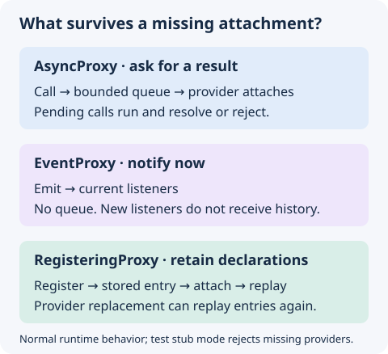

## Overview

A proxy is chosen by what must survive a provider change: a pending call, nothing from a past event, or a stored registration. The proxy tracks module ownership, so the runtime removes a module's callbacks and registrations when that module is destroyed. Resources that those callbacks create, such as sockets and timers, stay yours to release.

An async or registering proxy has one provider attachment. An event proxy has many listeners. State lives on each proxy object. When a project has several providers of one interface, the core evaluates a separate instance of the interface package for each provider, so the calls of each instance reach one provider. No call selects a provider at run time.

An ordinary request and response contract needs only [`InterfaceFunction`](#interfacefunction) and [`ImplementInterface`](#implementinterface). Direct attachment, leases, and ownership contexts are for provider and loader authors who need lifecycle control.

## Read the lifecycle before choosing a proxy

{width="480"}

| Situation          | Async call             | Event                                   | Registration                                                                       |
| ------------------ | ---------------------- | --------------------------------------- | ---------------------------------------------------------------------------------- |
| No attachment      | Queues up to the limit | No listener receives it                 | The proxy stores the entry                                                         |
| Attachment arrives | Pending calls run      | Later emissions reach listeners         | Stored entries replay                                                              |
| Attachment leaves  | New calls queue again  | Removed listener stops receiving events | Entries stay until something unregisters them or the runtime cleans up their owner |

The table describes normal runtime behavior. [Test stub mode](#missingprovidererror) rejects missing providers. Detaching an async callback does not cancel work already running. Detaching registration callbacks does not release provider resources.

## `AsyncProxy`

`AsyncProxy` wraps asynchronous function calls. It queues calls while no callback is attached and runs the queue once a callback attaches. The queue holds at most 1,000 pending calls. When it is full, later calls reject with `ProviderQueueFullError` until a callback attaches.

### Create and use an `AsyncProxy`

```ts
import { AsyncProxy } from "@antelopejs/interface-core";

const proxy = new AsyncProxy<(name: string) => string>();

// A call made before attachment waits in the queue
const result = proxy.call("Alice"); // Promise<string>

// Attaching a callback runs the queued call
proxy.onCall((name: string) => {
  return `Hello, ${name}!`;
});

// Later calls run at once
const greeting = await proxy.call("Bob"); // "Hello, Bob!"
```

### `onCall(callback, manualDetach?)`

Attaches the provider's callback and replaces any callback attached before, so a provider's new generation takes over from the old one. The proxy records the owner of the active module context and detaches the callback when that owner is destroyed. Releasing an older generation never detaches a newer one. `manualDetach: true` turns off this automatic cleanup.

The callback runs in the context it was attached in, which is the provider's, whatever module calls it. Inside the callback, `GetModuleContext` reports the provider across nested calls and `await`, and what the callback registers belongs to the provider. A callback attached in an interface package's own context runs in the caller's context instead. See [Ownership](#ownership).

```ts fragment
// Automatic cleanup (the default): detaches when the owner is destroyed
proxy.onCall(myHandler);

// Manual cleanup: keep the lease to detach this attachment only
const lease = proxy.onCall(myHandler, true);
proxy.detach(lease);
```

`onCall` returns an `AttachmentLease` with `owner: string` and `generation: number`. Pass the lease unchanged to `detach(lease)` to remove only that attachment. A stale lease cannot detach a replacement provider. The type comes from `@antelopejs/interface-core/proxies`. The package root does not re-export it.

```ts docs-check
import { AsyncProxy } from "@antelopejs/interface-core";
import type { AttachmentLease } from "@antelopejs/interface-core/proxies";

const proxy = new AsyncProxy<() => string>("greeting");
const oldLease: AttachmentLease = proxy.onCall(() => "old", true);
const currentLease = proxy.onCall(() => "current", true);
proxy.detach(oldLease); // The current provider stays attached.
const greeting: string = await proxy.call(); // "current"
proxy.detach(currentLease);
```

Manual detachment turns off only the automatic cleanup of the attachment. A callback attached by a generation that is later destroyed still runs when called, in that generation's context. Reading the module context or registering from inside it then throws `ModuleContextInvalidatedError`.

### `call(...args)`

Calls the attached callback and returns a `Promise`. With no callback attached, the call waits in the queue until a callback attaches. The queued call then runs as if it had just been made. It rejects with `ModuleContextInvalidatedError` if the caller's generation was destroyed in the meantime. A call made from a destroyed generation rejects with `ModuleContextInvalidatedError`. In test stub mode, a call with no callback attached rejects with a [`MissingProviderError`](#missingprovidererror).

### `detach()`

`detach()` removes the current callback whatever its lease. `detach(lease)` removes it only when the lease matches. After a detach, new calls queue again. Detaching does not cancel calls already running.

## `InterfaceFunction`

`InterfaceFunction` creates an `AsyncProxy` and returns a function that calls it. It is the usual way to declare an interface function.

```ts
import { InterfaceFunction } from "@antelopejs/interface-core";

// Declare a typed interface function
const GetUser =
  InterfaceFunction<(id: string) => { name: string; email: string }>();

// Call it like an async function
const user = await GetUser("user-123");
```

The return type is `(...args: Parameters<T>) => Promise<Awaited<ReturnType<T>>>`. `InterfaceFunction` and `AsyncProxy` take one type argument, the function type; the result type always comes from it. An optional identity string, as in `InterfaceFunction<T>("name")`, names the proxy for diagnostics.

The returned function carries a `.proxy` property at run time, but its declared type does not expose it. `ImplementInterface({ GetUser }, { GetUser: handler })` is the typed way to attach a provider. For direct attachment and lease control, construct an `AsyncProxy` as shown above. Do not reach for `.proxy` on an interface function.

## `EventProxy`

`EventProxy` holds a list of event handlers and removes each one when its owner is destroyed. Unlike `AsyncProxy`, it accepts many handlers and does not queue emissions.

### Create and use an `EventProxy`

```ts
import { EventProxy } from "@antelopejs/interface-core";

const onUserCreated = new EventProxy<(userId: string, name: string) => void>();

// Register a handler
onUserCreated.register((userId, name) => {
  console.log(`User created: ${name} (${userId})`);
});

// Emit the event to every registered handler
onUserCreated.emit("u-1", "Alice");
```

### `register(func)`

Registers a handler for the event. A second registration of the same function reference does nothing. The proxy records the owner of the active module context and removes the handler when that owner is destroyed. The handler runs in the context it was registered in, whatever module emits the event. A handler registered outside any context runs in the emitter's context.

### `emit(...args)`

Calls every registered handler synchronously with the given arguments. The runtime's error reporter receives each synchronous exception, and later handlers still run. `emit` does not await returned promises, so an asynchronous handler must handle its own rejections.

### `unregister(func)`

Removes one handler by function reference.

## `RegisteringProxy`

`RegisteringProxy` holds a register and unregister pair. It keys entries by an identifier and stores every entry so it can replay them when callbacks attach. The store has no cap, so registering entries with no attached provider never throws `ProviderQueueFullError`.

The type argument is the register signature, with the identifier first. Without one, the identifier and the arguments are `unknown`, so a callback narrows them before use.

### Create and use a `RegisteringProxy`

```ts fragment
import { RegisteringProxy } from "@antelopejs/interface-core";

const routeRegistry = new RegisteringProxy<
  (id: string, path: string, handler: Function) => void
>();

// The proxy stores these entries until a callback attaches
routeRegistry.register("home", "/", homeHandler);
routeRegistry.register("about", "/about", aboutHandler);

// Install both callbacks, then replay the stored entries
const lease = routeRegistry.onHandlers(
  (id, path, handler) => router.addRoute(path, handler),
  (id) => router.removeRoute(id),
);

// Unregister by ID
routeRegistry.unregister("about");
```

### `onHandlers(register, unregister, manualDetach?)`

Attaches both callbacks under one lease, then replays the stored registrations. Use this method to replace a provider. Replay can then call `unregister` safely, because the matching unregister callback is already in place. It returns one `AttachmentLease` for both callbacks. `ImplementInterface` attaches registering proxies through this method.

Replay reports each synchronous registration failure to the runtime error reporter and moves on to the next stored entry. When the reporter rethrows, the proxy detaches this lease's callbacks before the error propagates. Replay is not a transaction and does not roll back provider side effects. A direct `register` call passes a synchronous callback failure to its caller.

### `onRegister(callback, manualDetach?)`

Attaches only the register callback and returns its own lease. The stored entries replay through this callback at once. Automatic cleanup applies unless `manualDetach` is `true`. An existing unregister callback stays attached.

Direct registration and replay run in the context the callback was attached in, which is the provider's.

### `onUnregister(callback)`

Attaches only the unregister callback and returns a separate lease. It takes the owner and the manual-detach setting of an existing attachment that belongs to the active owner, checking the unregister attachment first and the register attachment second. With no active context, it takes them from the existing unregister attachment, then from the register attachment. With no such attachment, it uses the owner of the active context and turns on automatic cleanup. It does not replay registrations or replace the register callback.

Unregistration runs in the context this callback was attached in. That holds also when the release of the module that registered the entry triggers it.

### `register(id, ...args)`

Registers an entry under the given identifier. If a register callback is attached, it runs at once. Otherwise the proxy stores the entry and replays it when a callback attaches. The proxy records the owner of the active module context for cleanup. Registering an ID again replaces the stored arguments and owner and calls the register callback again, without a call to unregister first. Registering from a destroyed generation throws `ModuleContextInvalidatedError`.

### `unregister(id)`

Removes the entry with the given identifier and calls the unregister callback if one is attached. An unknown ID does nothing. The proxy removes the stored entry even when the callback throws.

### `detach()`

`detach()` removes both callbacks. `detach(lease)` removes only the callbacks that match the lease: both for `onHandlers`, or one for a separate `onRegister` or `onUnregister` attachment. Registered entries stay stored for replay. Detaching callbacks does not unregister provider resources.

### Ownership cleanup

`RegisteringProxy` and `EventProxy` expose `unregisterModule(module)` and `unregisterOwner(owner)` to remove the entries of a whole module or of one generation. Module destruction calls owner cleanup on its own. Application code usually needs only `unregister(id)` or `unregister(handler)`.

## Proxy identity helpers

All three proxy constructors accept an optional identity string. `GetInterfaceProxyIdentity(proxy)` returns a diagnostic identity prefixed by the proxy kind, for example `"async:greeting"`. Without an explicit name, the runtime generates an anonymous identity. A value that is not a proxy returns `undefined`.

`IsInterfaceProxy(value, kind?)` checks the brand of the shared runtime protocol, optionally limited to `"async"`, `"registering"`, or `"event"`. It works across compatible copies of the package where `instanceof` is unreliable. It returns a boolean and does not narrow a TypeScript type. Both helpers take proxy objects, not the function that `InterfaceFunction` returns.

## Ownership

Proxies track ownership so that hot reload can detach and unregister everything a module generation left behind. The owner of an attachment, a registration, or an event handler is the nearest module in the chain of work that made it, read from the async module context:

- **A module owns its own work.** That includes what it registers while it serves another module's call. A provider callback runs in the provider's context. So when module A calls B and B's provider registers on C, the entry on C is B's. Reloading B removes it, and destroying A does not.
- **A module that forwards registrations declares a `RegisteringProxy`.** When A registers on B and B's provider forwards to C, B's next generation receives A's entry again through replay and forwards it again. When A is destroyed, the runtime unregisters its entry on B, and B's unregister callback removes the entry on C.
- **Interface package code is never an owner.** The functions an interface package exports run in their caller's context, so what they forward belongs to the caller.
- **An interface package owns what it needs to work.** The core evaluates each interface package in a context of its own, of kind `"interface"`. The core releases that context's owner only when it discards that interface instance, never on a module reload. Code at the package's top level runs in that context, and so do the timers, promises, and event handlers it creates. A provider callback attached there is the exception. It only carries calls and registrations forward for a caller, so it runs in the caller's context.

Values cross unchanged. The arguments to `AsyncProxy.call`, `RegisteringProxy.register`, and `EventProxy.emit` reach the other side as the same values. A class keeps the identity that its metadata and registries use as a key, and a function can be unregistered by reference.

### Limits

- A function passed as an argument and called later by the provider runs in the context of whoever calls it, and what it registers belongs to that module. A callback that outlives the call belongs in a `RegisteringProxy` entry, not in the arguments of `AsyncProxy.call`.
- Work that an interface package starts lazily, from inside a function it exports and not from its top level, belongs to the module that called first.
- The core enters an interface package's context only for packages loaded through `require()`. A package reached through an ECMAScript `import` is evaluated in its importer's context, so its top-level work belongs to that importer.

## `ImplementInterface`

`ImplementInterface` connects an interface declaration to its implementation. It walks the declaration object and attaches each proxy to the matching member of the implementation.

```ts
import {
  InterfaceFunction,
  EventProxy,
  RegisteringProxy,
  ImplementInterface,
} from "@antelopejs/interface-core";

// Declaration
const GetItem = InterfaceFunction<(id: string) => { name: string }>();
const OnItemAdded = new EventProxy<(id: string) => void>();
const ItemRegistry = new RegisteringProxy<
  (id: string, data: unknown) => void
>();

const ItemInterface = { GetItem, OnItemAdded, ItemRegistry };

// Implementation
const store = new Map<string, unknown>();

ImplementInterface(ItemInterface, {
  GetItem(id: string) {
    return { name: `Item ${id}` };
  },
  ItemRegistry: {
    register(id: string, data: unknown) {
      store.set(id, data);
    },
    unregister(id: string) {
      store.delete(id);
    },
  },
});
```

`ImplementInterface` skips `EventProxy` entries in the declaration. The declaring side emits events, so a provider has nothing to implement for them.

The declaration is any object (`T extends object`). A declaration typed by an `interface`, which has no index signature, is accepted. The implementation's type is `InterfaceToImpl<T>`, exported from the package root. In it every member is optional. An `InterfaceFunction` member is implemented by a function that returns the value or a promise of it. An `AsyncProxy<F>` member is implemented by an `F` exactly, so a synchronous `F` takes no `async` function. A registering proxy is implemented by `{ register, unregister }`. An event proxy takes nothing (`never`). A nested object takes its own `InterfaceToImpl`.

```ts
import {
  AsyncProxy,
  ImplementInterface,
  type InterfaceToImpl,
} from "@antelopejs/interface-core";

interface ClockInterface {
  now: AsyncProxy<() => number>;
}

const clock: ClockInterface = { now: new AsyncProxy<() => number>() };
const implementation: InterfaceToImpl<ClockInterface> = {
  now: () => Date.now(),
};

ImplementInterface(clock, implementation);
const time: number = await clock.now.call();
```

The synchronous overload returns `{ declaration, implementation }`. Every declared async proxy needs a function, and every registering proxy needs both `register` and `unregister`, although `InterfaceToImpl` marks the keys optional. A missing or malformed handler, an argument that is not an object, and an object cycle each throw `TypeError`. Validation runs before any attachment. When attaching one handler throws, for example because a replayed registration fails and the runtime error reporter rethrows, every handler the call attached is detached by its own lease before the error propagates. Consumers then see no provider rather than part of one. A provider that another call attached stays attached. Effects of provider callbacks during attachment are not rolled back. Promise-like arguments select an asynchronous overload marked `@deprecated`. Use the synchronous form.

## `MissingProviderError`

In test stub mode, using a proxy with no provider attached fails with a `MissingProviderError`. `AsyncProxy.call` rejects with it, and `RegisteringProxy.register` throws it.

This error is the supported way to detect a missing provider. The contract is the type and its stable `code` property, `"ERR_NO_PROVIDER"`, exported as `MISSING_PROVIDER_CODE`. The message text is not part of the contract and can change.

```ts fragment
import {
  isMissingProviderError,
  MissingProviderError,
} from "@antelopejs/interface-core";

try {
  registry.register("my-entry", data);
} catch (error) {
  if (!isMissingProviderError(error)) throw error;
  // Tolerate the missing provider
}
```

The `isMissingProviderError` guard is more reliable than `instanceof`. It checks the `code` property, so detection keeps working across realm boundaries and across duplicated copies of the package, where `instanceof` fails.

## Other public errors

The package root exports the errors. Match on their stable `code` values, not on messages.

| Error                           | Code constant                     | Code value                       | When it applies                                                                                                                  |
| ------------------------------- | --------------------------------- | -------------------------------- | -------------------------------------------------------------------------------------------------------------------------------- |
| `ProviderQueueFullError`        | `PROVIDER_QUEUE_FULL_CODE`        | `ERR_PROVIDER_QUEUE_FULL`        | An unattached async proxy reaches its pending-call limit (1,000 by default).                                                     |
| `ModuleContextInvalidatedError` | `MODULE_CONTEXT_INVALIDATED_CODE` | `ERR_MODULE_CONTEXT_INVALIDATED` | Work tries to use a destroyed ownership context.                                                                                 |
| `AmbiguousProviderError`        | `AMBIGUOUS_PROVIDER_CODE`         | `ERR_AMBIGUOUS_PROVIDER`         | Represents ambiguous provider routing. The single-provider proxy classes do not throw it themselves or choose between providers. |

## `GetInterfaceInstances` and `GetInterfaceInstance`

These functions return the active interface connections of the module whose work is running. Outside a module context, `GetInterfaceInstances` returns an empty array and `GetInterfaceInstance` returns `undefined`.

```ts
import {
  GetInterfaceInstances,
  GetInterfaceInstance,
} from "@antelopejs/interface-core";

// Get all connections for an interface
const connections = GetInterfaceInstances("database");

// Get a specific connection by ID
const primary = GetInterfaceInstance("database", "primary");
```

Each `InterfaceConnection` holds the path to `require()` for the interface instance bound to that connection, the provider's module ID, and whether a plain import reaches this connection. The provider ID is absent for a connection to a self-hosted interface.

```ts
interface InterfaceConnection {
  id?: string;
  path: string;
  provider?: string;
  selected: boolean;
}
```

Requiring a connection's `path`, or a subpath of it, gives the interface bound to that connection's provider. The objects built from it stay bound to that provider wherever they are used.

## `GetResponsibleModule`

`GetResponsibleModule` returns the module of the active async module context, or `undefined` outside any context. It never inspects the call stack.

```ts
import { GetResponsibleModule } from "@antelopejs/interface-core";

const moduleId = GetResponsibleModule();
```

## `RunWithResponsibleModule`

`RunWithResponsibleModule` sets the responsible module for synchronous and asynchronous work. This module owns the proxy registrations made in the callback. A nested context restores its parent when it completes, also when the callback throws.

```ts fragment
import { RunWithResponsibleModule } from "@antelopejs/interface-core";

await RunWithResponsibleModule("my-module", async () => {
  proxy.onCall(myHandler);
  await initializeModule();
});
```

The module loader wraps every module-owned entry point, module evaluation and lifecycle hooks included. Work done outside any context has no owner. Its attachments belong to a default owner that no module release removes, and no owner release ever removes its registrations.

An ownership context belongs to one loaded module generation. A loader that can run an old and a replacement instance at the same time uses `RunWithModuleContext` from `@antelopejs/interface-core/modules` with a unique `owner` for each generation. When `Events.ModuleDestroyed` is emitted inside a context of the destroyed module, it invalidates and cleans up only that context's owner. The event still carries the module ID. Detached asynchronous work of that owner then receives a `ModuleContextInvalidatedError`.

## Next steps

- [Decorators](./3.decorators.md) builds typed decorator factories.
- [Metadata](./4.metadata.md) reads and creates reflection metadata.
